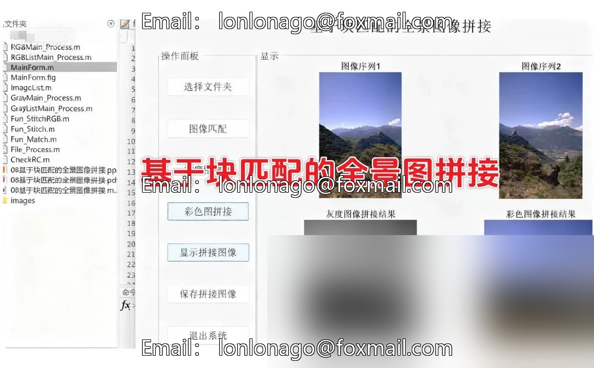

# Based on block matching scene image concatenation (Matlab) including GUI

## Body

Object-based full image stitching (Matlab) containing GUI; includes source code + presentation PPT + runtime video

Implementation method:
Use block matching algorithm to perform panoramic image splicing
Determine the overlapping region, calculate geometric transformation parameters
Use image fusion technology to eliminate splicing seam

PPT includes design background, algorithm flow, algorithm principles, experimental results display, and conclusions and outlook. (It can be directly written into a report based on the PPT and source code.)
Contains some code comment documentation, very practical, ready to use as is.

web-based shipment, can be directly photographed and shipped.

The content covers block-matching panorama stitching via Matlab, including a GUI, source code, PPT presentation, run videos, folder files, image sequences, color and grayscale stitching results, image display and saving.

<!-- AI_ENRICHED -->

## Images

## Payment

Here is a pay link on Stripe ( https://buy.stripe.com/3cs8yP7sY87d0vu9AB ). Please contact me lonlonago@foxmail.com after funding $89, and I will send you a complete data files , thank you!

